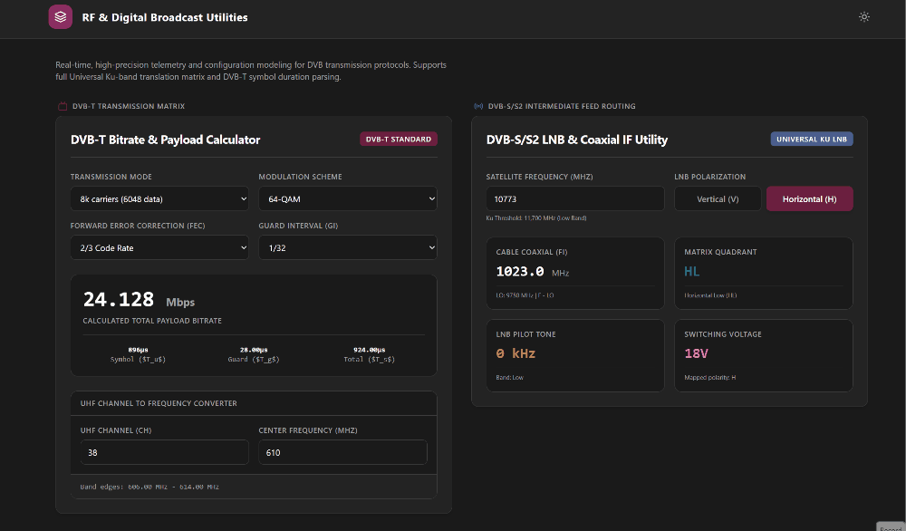
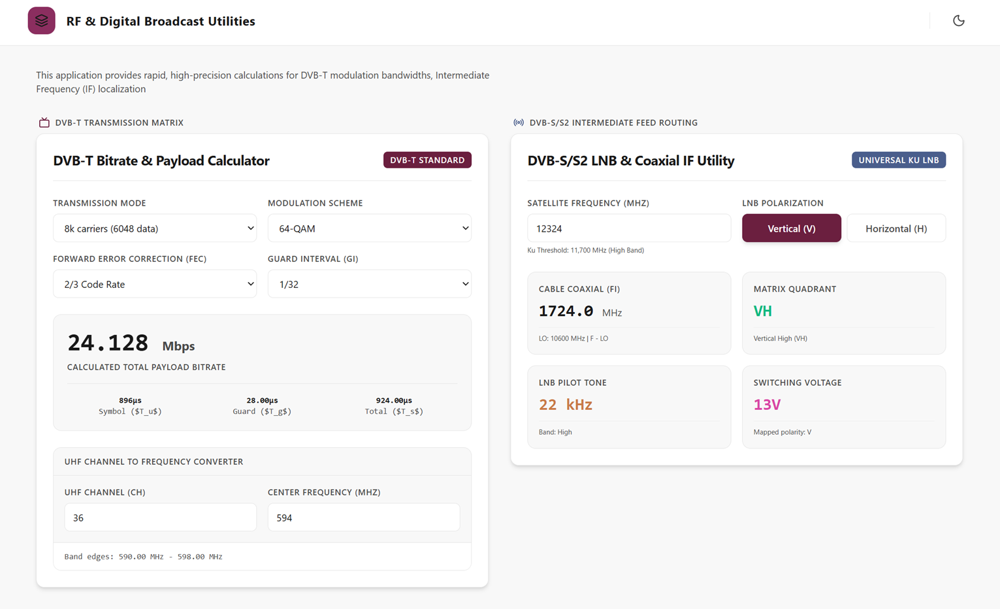
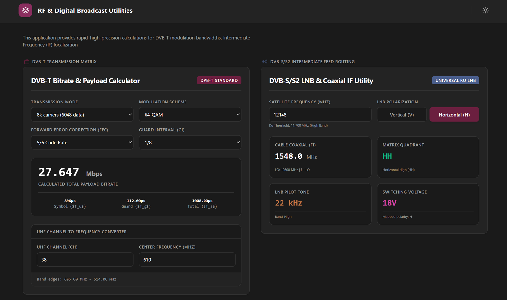

# RF & Digital Broadcast Utilities



A specialized engineering utility designed for broadcast technicians and RF engineers. This application provides rapid, high-precision calculations for DVB-T modulation bandwidths, Intermediate Frequency (IF) localization, and Matrix Quadrant alignments. By streamlining complex RF parameter computations, it ensures optimal transmission configuration and signal integrity for digital terrestrial broadcasting deployments.

<p align="center">
  
  
</p>

## ✨ Key Features
- **DVB-T Bitrate & Payload Calculator**: Enables real-time modeling of DVB-T (EN 300 744) signal structures and payload bitrates:
  - **Transmission Modes:** 2k & 8k carriers.
  - **Modulation Schemes:** QPSK, 16-QAM, and 64-QAM.
  - **Forward Error Correction (FEC):** Code rates of 1/2, 2/3, 3/4, 5/6, and 7/8.
  - **Guard Intervals (GI):** 1/4, 1/8, 1/16, and 1/32.
  - **Real-Time Symbol Telemetry:** Symbol duration (T_u), Guard duration (T_g), and Total duration (T_s) calculated in microseconds (µs).
  - **UHF Channel Converter:** DVB-T standard UHF channel input mapping to center frequency and band edges (UHF Channels 21–48 / 474–690 MHz).
- **DVB-S/S2 Intermediate Feed Calculator**: Enables high-frequency Intermediate Feed routing calculations for satellite LNB Universal Ku-Band configurations:
  - **Frequency Band Conversion:** Translates satellite RF downlinks to L-Band Intermediate Frequencies (IF) based on high/low local oscillator (LO) frequency matrices.
  - **Polarization Handling:** Models vertical/horizontal and left/right circular polarizations.

## 🚀 Getting Started (Local Installation)

If you want to run or modify this project locally, follow these simple steps. We use **[pnpm](https://pnpm.io/)** for managing dependencies as it is faster and more efficient.

1. **Clone the repository**:
   ```bash
   git clone https://github.com/FluxFae/Calculator-Bitrate-DVB-T-and-IF-Satellite.git
   cd prj-calculator-bitrate
   ```

2. **Install dependencies**:
   Make sure you have `pnpm` installed. Then run:
   ```bash
   pnpm install
   ```

3. **Start the development server**:
   ```bash
   pnpm run dev
   ```
   This will start the local server. Open the link provided in your terminal (usually `http://localhost:5173`) to view the application in your browser.

## ⚙️ Tech Stack
- **Frontend**: React 19, TypeScript 5+, Vite 6, Tailwind CSS v4.0.0.
- **Icons**: Lucide React.

*(No backend applies, this is a 100% local/client-side tool)*.

## 🤖 Development & Vibecoding
This project was orchestrated using vibecoding methodologies with AI agents. The development workflow prioritizes rapid problem resolution and iterative AI collaboration over manual implementation.

## 🚧 Project Status (As-Is) & Contributions
This is a personal use tool open-sourced for the community. It currently does not have active maintenance or a planned development roadmap.

If you find this tool useful, discover a bug, or want to add an improvement, Pull Requests are welcome. I will review and integrate community contributions based on availability.

## 📜 License
Distributed under the MIT License.
